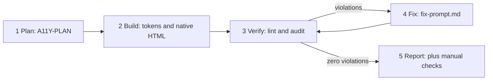
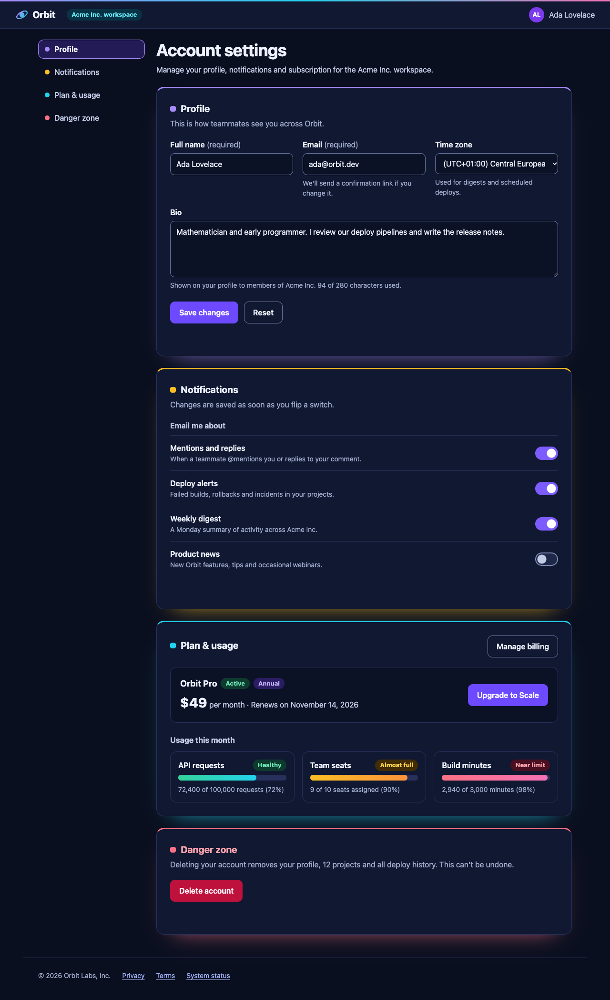
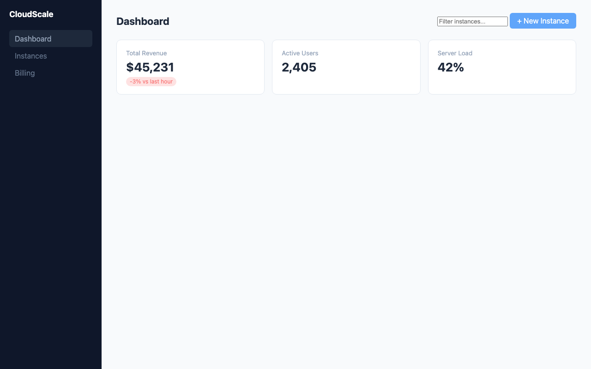
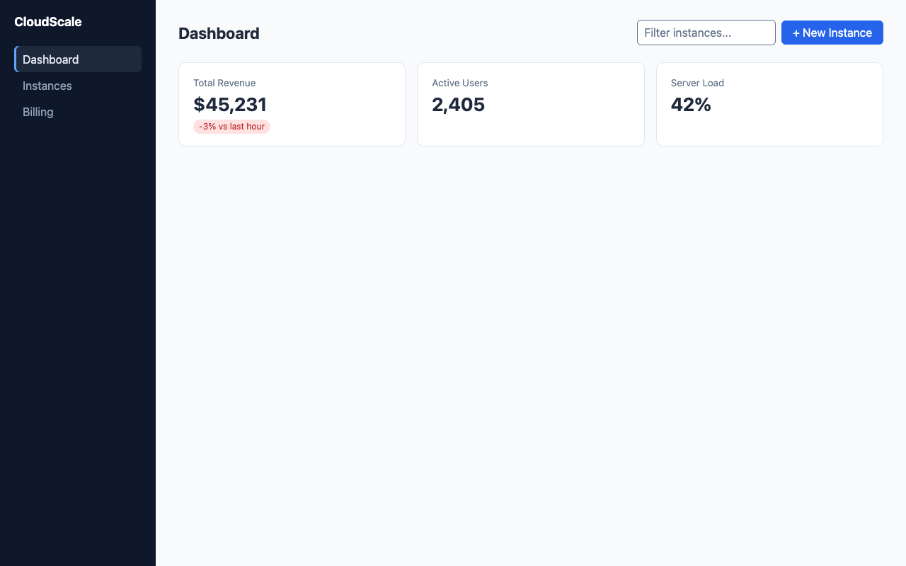

# Born-Accessible UI

**Teach your AI coding agent to build accessible frontends on the first pass, and prove it with an automated check.**

[](LICENSE)
[](https://nodejs.org/)
[](https://agentskills.io)

The companion kit to the a11yTO Conf 2026 talk **"The Aesthetic-A11y Paradox: Taming Modern LLMs for Born-Accessible Code"** by [Dirk Ginader](https://dir.kg).

Drop this folder into your project and point your coding agent (Claude Code, GitHub Copilot, Gemini CLI, Codex, Cursor, ...) at it. From then on, every UI it builds is planned for accessibility, uses verified color contrast and native HTML, and gets checked with Playwright + axe-core before the agent calls it done.

---

## Contents

- [Why this exists](#why-this-exists)
- [How it works](#how-it-works)
- [Quick start](#quick-start)
- [What's inside](#whats-inside)
- [The tools](#the-tools)
- [What it looks like in practice](#what-it-looks-like-in-practice)
- [What automated checks can't tell you](#what-automated-checks-cant-tell-you)
- [Troubleshooting](#troubleshooting)
- [Further reading](#further-reading)
- [License](#license)

---

## Why this exists

Modern LLMs produce polished, visually rich interfaces in seconds. That polish creates a halo effect: the UI *looks* finished, so it ships, along with missing landmarks, unreachable controls and unreadable text.

In the longitudinal study behind the talk (16+ rounds of AI-generated UI, every component audited with Playwright and axe-core):

- **Color contrast was the #1 failure** (47% of violations in the earlier rounds). Models write colors as text tokens; they don't compute luminance.
- **Naive prompt fixes backfired.** Locking the palette produced the worst round of all (158 violations). Banning grey "worked" only through monochrome designs.
- **What worked:** structured protocols plus deterministic verification. In short, *treat prompts like lint configs*.

This kit packages those protocols and the verification loop so you can use them in your own projects.

## How it works



1. **Plan (Protocol 1: Silent Reasoning).** Before writing markup, the agent maps landmarks, headings, controls (native elements and keyboard behavior) and every color pair.
2. **Build (Protocols 2 and 3).** Color tokens carry *computed* contrast assertions (`/* Contrast: 6.7:1 vs #1d4ed8 (AA) */`), and native HTML comes before ARIA (`<button>`, `<dialog>`, `<details>`, `<label>`).
3. **Verify.** `lint.mjs` recomputes every contrast claim and flags clickable `<div>`s. `audit.mjs` runs axe-core in a real browser on the page *and* its hidden states, plus a 320px reflow check.
4. **Fix.** The audit writes `fix-prompt.md` with exact selectors, colors and required ratios. The agent fixes at the source and re-checks, for at most 3 rounds.
5. **Report.** The agent reports "0 automated violations", never "WCAG compliant", and lists the manual checks that remain.

## Quick start

### 1. Add the kit to your project

Download this repository (**Code → Download ZIP**) and extract it into your project as `a11y-kit/`, or run:

```bash
git clone --depth 1 https://github.com/ginader/born-accessible-ui.git a11y-kit
rm -rf a11y-kit/.git
```

### 2. Install the audit dependencies (once)

```bash
npm install --save-dev playwright @axe-core/playwright
```

The audit uses your installed Google Chrome. If you don't have Chrome, also run `npx playwright install chromium`.
No `package.json` in your project? Run `npm install` inside `a11y-kit/` instead.

### 3. Point your agent at it

Pick whichever option fits your tool:

| Your tool | What to do |
| :--- | :--- |
| **Agents with Agent Skills support** | Copy `a11y-kit/born-accessible-ui/` into your project's skills folder, for example `.claude/skills/` (Claude Code) or `.github/skills/` (GitHub Copilot in VS Code). Other agents document their own folder. The skill then activates for UI work. |
| **Any agent that reads an instructions file** | Add the snippet below to `AGENTS.md`, `CLAUDE.md`, `GEMINI.md` or `.github/copilot-instructions.md`. |
| **Chat-only LLMs** (no file or terminal access) | Paste [`born-accessible-ui/references/protocols.md`](born-accessible-ui/references/protocols.md) in as the system prompt or custom instructions. Run the audit yourself and paste `a11y-report/fix-prompt.md` back into the chat. |

```markdown
## Accessibility
For any UI work, read and follow `a11y-kit/born-accessible-ui/SKILL.md`
(plan, build, verify with its scripts, fix, report).
```

### 4. Try it

```bash
node a11y-kit/born-accessible-ui/scripts/audit.mjs a11y-kit/examples
```

`before-unguided.html` fails (contrast, landmarks, headings, a placeholder-only label, reflow). `after-born-accessible.html` passes, including its dialog. Open `a11y-report/report.html` to browse the results, and add `a11y-report/` to your `.gitignore`.

### 5. Build something

Prompt as usual, for example:

> Build a settings page with a profile form, notification toggles and a delete-account dialog.

The agent writes an `A11Y-PLAN`, builds the page, runs both checks, and fixes findings until the audit is clean. It then tells you what still needs manual testing.

## What's inside

| Path | What it is |
| :--- | :--- |
| [`born-accessible-ui/`](born-accessible-ui/) | The Agent Skill ([agentskills.io](https://agentskills.io) format). This one folder holds the whole workflow. |
| [`born-accessible-ui/SKILL.md`](born-accessible-ui/SKILL.md) | The workflow: Plan → Build → Verify → Fix → Report. |
| [`born-accessible-ui/references/protocols.md`](born-accessible-ui/references/protocols.md) | The three Born-Accessible protocols. Also works as a copy-paste system prompt. |
| [`born-accessible-ui/references/remediation.md`](born-accessible-ui/references/remediation.md) | How to fix each finding without breaking the design. |
| [`born-accessible-ui/scripts/audit.mjs`](born-accessible-ui/scripts/audit.mjs) | Runtime audit with Playwright + axe-core. |
| [`born-accessible-ui/scripts/lint.mjs`](born-accessible-ui/scripts/lint.mjs) | Static checks with no dependencies. |
| [`examples/`](examples/) | A "before" (unguided) and an "after" (born-accessible) page to try the tools on. |

## The tools

### `audit.mjs`: runtime audit

```bash
node a11y-kit/born-accessible-ui/scripts/audit.mjs http://localhost:5173/ http://localhost:5173/settings
node a11y-kit/born-accessible-ui/scripts/audit.mjs dist/                        # every .html file, recursively
node a11y-kit/born-accessible-ui/scripts/audit.mjs page.html --click "#open-filters"
```

- **Standards:** runs axe-core with the WCAG 2.0, 2.1 and 2.2 A/AA rules plus best practices.
- **Hidden UI:** audits the initial view **and** hidden states: native `<dialog>`s, `[popover]`s, closed `<details>`, inactive tabs, and `aria-expanded`/`aria-haspopup` triggers. Use `--click` for UI that only exists after a click.
- **Extra checks axe doesn't do:**
  - reflow at 320 CSS px (WCAG 1.4.10), with clues to the CSS that overflows
  - inputs named only by a `placeholder`
  - truncated LLM output
- **"Needs review" items** (for example text on gradients) are listed instead of silently passing.
- **Output:** writes `a11y-report/report.json`, `report.html` (static, works offline) and `fix-prompt.md`.
- **Exit codes:** `0` clean, `1` violations, `2` setup or page-load problem. Run with `--help` for all options.

### `lint.mjs`: static checks

```bash
node a11y-kit/born-accessible-ui/scripts/lint.mjs src/
```

- Recomputes every `/* Contrast: X.X:1 vs #bg (AA) */` comment and fails when the claim is wrong. Models estimate these numbers, and so do humans.
- Flags `onClick`/`@click` on `<div>`/`<span>` and `role="button"` on non-buttons. Axe can't see either.
- Warns when outlines are removed and no focus style exists.

### In CI

Both scripts exit non-zero on findings, so they can gate a pull request:

```bash
node a11y-kit/born-accessible-ui/scripts/lint.mjs src/
node a11y-kit/born-accessible-ui/scripts/audit.mjs http://localhost:4173/   # start your preview server first
```

## What it looks like in practice

While preparing the talk, a coding agent got a fresh project containing only this kit and the `AGENTS.md` snippet above. Nobody explained the kit to it.

**Building from scratch.** We asked for a dark-mode settings page with a form, toggle switches, usage meters, a delete dialog and "accent colors generously".
- The first version had **0 automated violations**, including inside the dialog.
- All 53 of its contrast claims checked out.



**Repairing a legacy page.** The agent took `examples/before-unguided.html` from **6 failing rules (15 elements) plus 4 lint errors to 0 in two rounds**, keeping the layout and color direction.

| Before: 6 failing rules | After: 0 violations |
| :---: | :---: |
|  |  |

*These are single runs, meant as an illustration rather than a benchmark.*

## What automated checks can't tell you

Zero violations is a strong baseline, **not** a claim of WCAG conformance. Automated tools find only a portion of real-world barriers. Always finish with:

- a keyboard walk-through (Tab, Shift+Tab, Enter, Space, Esc, arrow keys in composite widgets)
- a visible focus indicator on every control
- a screen reader spot check of names, roles and states
- 200% zoom and 400% reflow
- a review of alt text, link text and error messages

## Troubleshooting

| Message | What to do |
| :--- | :--- |
| `[SETUP] Missing dependencies` | Run `npm install --save-dev playwright @axe-core/playwright` in your project (or `npm install` inside `a11y-kit/`). |
| `[SETUP] No browser found` | Install Google Chrome, or run `npx playwright install chromium`. |
| `Could not connect to http://localhost:... Is the dev server running?` | Start your dev server first, then re-run the audit with its URL. |
| `review` lines in the output | These are not failures; axe couldn't decide. Check each one by eye. See "Needs review" in [`remediation.md`](born-accessible-ui/references/remediation.md). |
| `Note: Playwright's own Chromium isn't installed` | The audit fell back to your Chrome. For identical results on every machine, run `npx playwright install chromium`. |

## Further reading

- [Intopia web accessibility skill](https://github.com/Intopia/intopia-web-accessibility-skill)
- [Check & fix accessibility skill](https://github.com/Neha/check-fix-accessibility)
- [Accessibility skill by idevabatista](https://github.com/idevabatista/accessibility-skill)
- [Community accessibility agents](https://skillsllm.com/skill/accessibility-agents)
- [Can AI agent skills help developers ship accessible code?](https://intopia.digital/articles/can-ai-agent-skills-help-developers-ship-accessible-code/) (Intopia)
- [Building accessibility into Figma Make prototypes](https://intopia.digital/articles/building-accessibility-into-figma-make-prototypes/) (Intopia)
- [Agent Skills specification](https://agentskills.io/specification)

Feedback and ideas are welcome in [GitHub issues](https://github.com/ginader/born-accessible-ui/issues).

## License

Licensed under the [Apache License 2.0](LICENSE).

Playwright (Apache-2.0) and axe-core (MPL-2.0) are not bundled. They are installed from npm and keep their own licenses.
